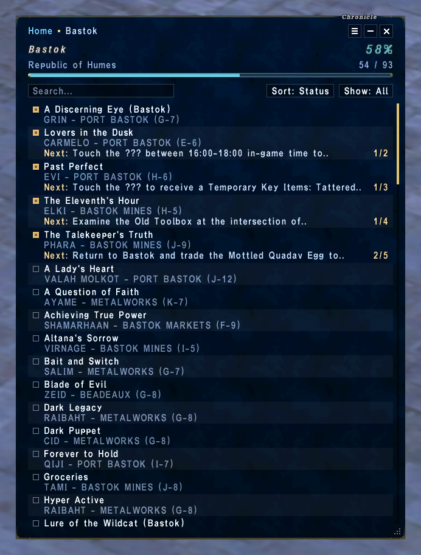
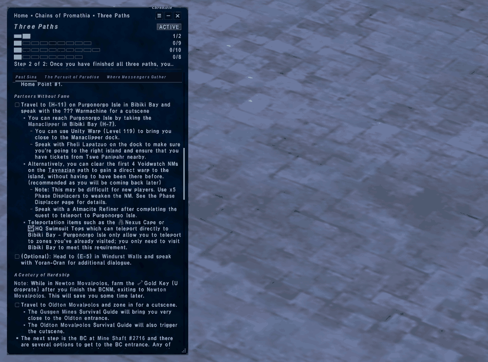
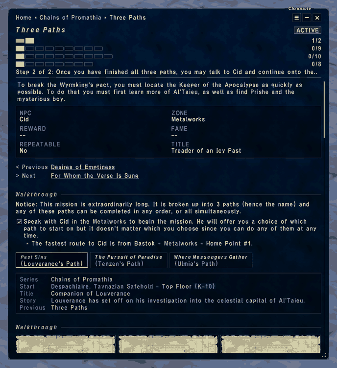
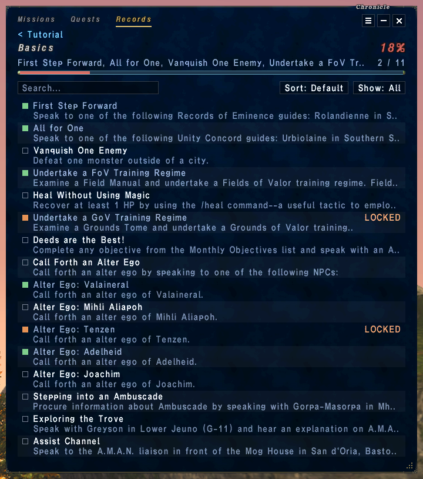
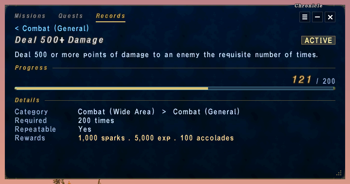
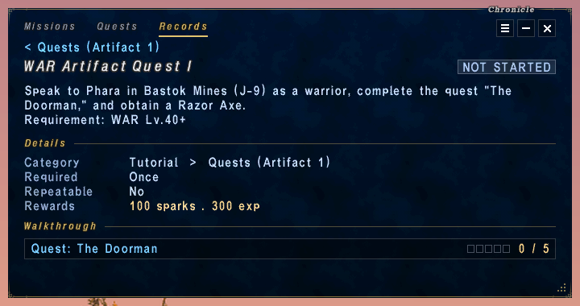
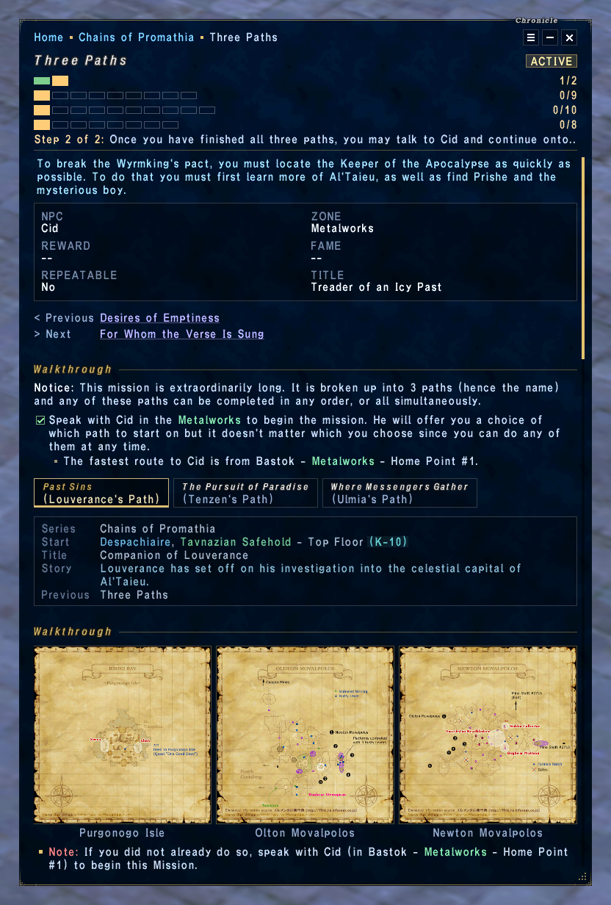
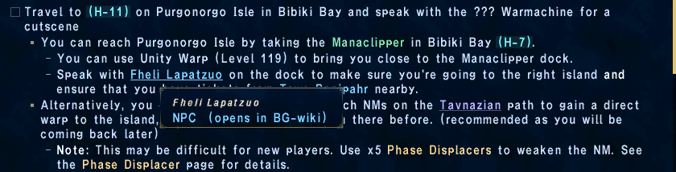
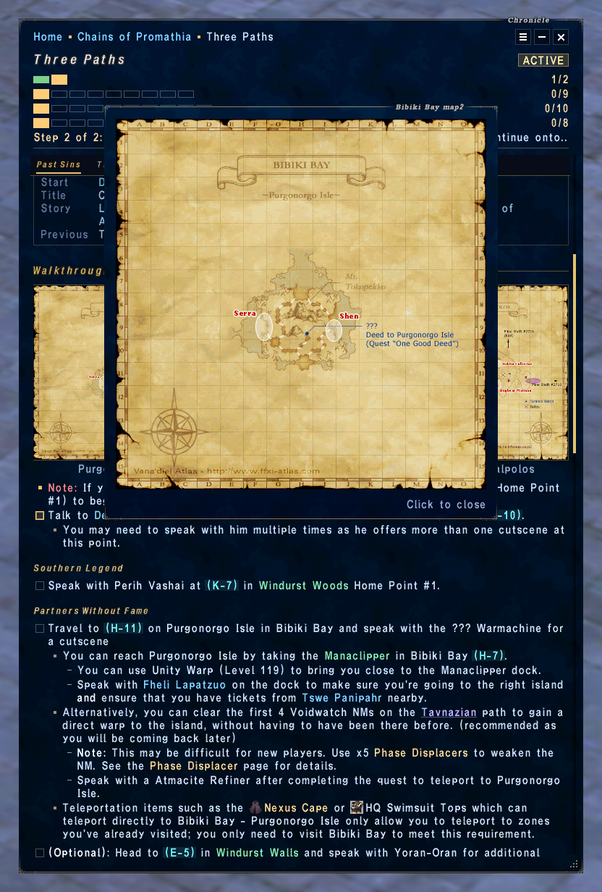

# Chronicle

[](https://github.com/jintawk/ffxi-chronicle/actions/workflows/tests.yml)
[](https://github.com/jintawk/ffxi-chronicle/releases/latest)
[](https://github.com/jintawk/ffxi-chronicle/releases)
[](LICENSE)

A quest and mission tracker for Final Fantasy XI, drawn in the game's own windows.

Chronicle shows your completion across every quest area, mission storyline and Records of Eminence
category, lets you browse and search them, checks your bags for what a quest needs, and shows the
walkthrough from BG-wiki with its headings, links, maps and tabs intact.


Version 2 replaces version 1's Windower text boxes with a native drawing layer. The window frame,
the fonts, the gauges and the item icons are read out of the game's own files and drawn above the
game's interface, in whichever of the eight window styles you have set in the game's Config.

- [Features](#features)
- [Installation](#installation)
- [Using it](#using-it)
- [With a controller](#with-a-controller)
- [Commands](#commands)
- [What is tracked](#what-is-tracked)
- [Walkthroughs](#walkthroughs)
- [Pictures and credits](#pictures-and-credits)
- [The native layer](#the-native-layer)
- [Upgrading from version 1](#upgrading-from-version-1)
- [Licence](#licence)

## Features

- Completion for 11 quest areas, 15 mission storylines and all 1,508 Records of Eminence
  objectives, read from the game's own quest log and record log
- A home screen with Missions, Quests and Records tabs, overall completion, a card per area, and
  what is in progress with the next step of each
- Every Records objective with its goal, its rewards, whether it repeats, and the server's own
  live count for the ones you have set
- Area lists with search, four sort orders and five filters; an active entry shows its next step
  and how far through it you are
- Guide details per entry: status, description, starting NPC and zone, reward, fame, title, and the
  previous and next entries in the chain
- Requirements checked against every bag and your key items, with the items' own icons
- 1,916 walkthrough pages converted from BG-wiki, with headings, lists, coloured links, item icons,
  boss tables, maps and tabbed panels
- The game's window art in any of its eight window styles, following the game's Config
- Drag to move, drag an edge or the corner to resize, with the text re-wrapping and your place kept
- A controller works too: press both sticks, and the D-pad moves a cursor over everything you could click
- Window place and size saved per character and per screen size

## Installation

Download the zip from the [latest release](https://github.com/jintawk/ffxi-chronicle/releases/latest)
and copy the `chronicle` folder inside it into `Windower/addons/`, then load it:

```
//lua load chronicle
```

The folder has to be called `chronicle`: Windower loads an addon from
`addons/<name>/<name>.lua`, so GitHub's "Source code (zip)", which unpacks as `ffxi-chronicle-x.y.z`,
will not load until it is renamed.

`libs/_chronicle.dll` is the native drawing layer: 32-bit, built from `plugin/`. If it cannot draw,
because it did not load or because a game update moved the code it looks for, Chronicle says so in
the chat log and then stays out of the way. It draws nothing and takes no input.

The DLL needs the Universal C Runtime, which Windows 10 and 11 include. On Windows 7 or 8.1,
install update KB2999226 first or the DLL will not load.

If Chronicle says `assets missing`, it could not read something out of your game installation. The
message names each piece, why, and the folder it read from, for example
`window art missing (ROM\0\19.DAT: newtex 256x256 not 128x128); ... ; in C:\...`. Only the chat font
is required: without the window art Chronicle draws a plain window instead. If it will not draw at
all, open an issue with that whole line in it.

To build the DLL yourself rather than use the one in the repository:

```sh
sh plugin/build.sh
```

It needs MinGW-w64 i686 and nothing else. The drawing library is
[nui](https://github.com/jintawk/nui), vendored in `plugin/nui`.

## Using it

`//cr` shows or hides the window. Missions, Quests and Records sit at the top of every screen, so
you can always see which of the three you are in, and each one takes you to that section's home.
Click a card, a row or a link to go in; click the blue line above the title, or right-click
anywhere in the window, to go back. Hovering a link shows where it goes. The three
buttons at the top right open Settings, collapse the window, and hide it.



Completion appears when you zone or complete an objective, because that is when the game sends the
quest log. Nothing is sent to the server, and no packet is injected: Chronicle only reads.

### Resizing



The paragraphs re-wrap as the window changes width, and your reading position is kept rather than
jumping to the top.

### Scrolling



## With a controller

Press **L3 and R3 together** (both sticks in) to give the controller to Chronicle. Press them again to give it
back. You can choose two other buttons for this (see below). While Chronicle has it, the game does not see what you press, so the D-pad moves Chronicle's cursor
and not the game's.

The game never sees the L3 + R3 chord either, so it does not also sit you down or change the camera. To make
that work, an L3 or R3 pressed on its own reaches the game up to 150 ms late. In that time, Chronicle waits for
the other one. A quick tap of one still reaches the game.

| Button | What it does |
|---|---|
| D-pad or left stick | Move the cursor: cards, rows, buttons, links, path tabs |
| Confirm (A) | Open what the cursor is on |
| Cancel (B) | Back. On a section's home, it gives the controller back to the game, or hides the window (see below) |
| LB / RB | The previous or next section: Missions, Quests, Records |
| LT / RT | A page up or down |
| Right stick | Scroll |
| X / Y | Sort / Show, on a list |
| Start | Settings |
| Back | Collapse or expand |
| R3 | The top of the page |

Confirm and Cancel are the buttons you set in the game's own pad config, so if your Confirm is B, Chronicle's
is too. A line at the bottom of the window names them while Chronicle has the controller.

On a long walkthrough, the D-pad goes from link to link. Where there is a long stretch of text with nothing to
click, it scrolls by a third of a page instead, so you can read the whole page with it. Going back puts the
cursor on the card or row you came from.

To close the window with Cancel, set "Hide on Back" to On on the Settings screen, or use `//cr autohide on`. Cancel
on a section's home then hides the window. Chronicle gives back the controller, and the keys too if it has them. The
Cancel you pressed stays away from the game until you let go of it. L3 + R3 shows the window again and takes the
controller.

Cancel that goes back a screen, closes a picture or leaves the search box does not hide the window. L3 + R3 and
`//cr pad` never hide it. The setting is off by default.

A button you were already holding when you pressed L3 + R3 still belongs to the game until you let go of it. A
button you pressed while Chronicle had the controller stays away from the game until you let go of it, even if you
give the controller back first. The game never sees half a press. Moving the mouse over the window gives the
hover back to the mouse until you next use the controller.

The controller has to be in the game's **XInput** mode: in the FFXI Config, on the Gamepad tab, turn on Enable
XInput. Chronicle reads the controller only the way the game reads it, and in DirectInput mode it does not read
it at all. `//cr pad status` says whether it is reading the controller, and why not. Steam Input can remap a pad
behind the game's back, so turn it off for FFXI.

`//cr pad` does what L3 + R3 does, so it can be bound to a key with Windower's `bind`. `//cr pad off` stops
Chronicle reading the controller at all, and the Settings screen has the same switch.

L3 + R3 is the default chord. To use two other buttons, click "Controller buttons" on the Settings screen, or
move the cursor to it and press Confirm. Then hold the two buttons you want together. Chronicle holds the
controller while it waits, so the game sees none of these presses.

To keep the old chord, press Escape on the keyboard, or press Cancel alone. A wait of 5 seconds with no press
also keeps it.

`//cr pad chord <name>` also sets the chord, for example `//cr pad chord lb+rb` or `//cr pad chord back+start`.
The names are l3, r3, lb, rb, back, start, a, b, x and y. `//cr pad chord` alone names the chord. The hint line
and the rest of this section then mean your chord where they say L3 + R3.

The D-pad cannot be in the chord, because it moves the cursor. A trigger cannot be in it either. The hook cannot
hold a trigger back from the game, so the game would see the trigger first.

Each button of the chord waits for its partner. In the game, it arrives up to 150 ms late, as L3 and R3 do now.
In Chronicle, it acts when you let go of it, so LB alone still goes to the previous section. If the chord does
not use R3, R3 goes to the top as soon as you press it.

## With a keyboard

Press **K** to drive Chronicle's cursor from the keyboard. Press K again to give the keys back to the game. This
also works for a pad that Steam Input, DS4Windows or reWASD maps to keys.

| Key | What it does |
|---|---|
| Arrow keys | Move the cursor: cards, rows, buttons, links, path tabs |
| Enter | Open what the cursor is on |
| Backspace or Escape | Back. On a section's home, it gives the keys back to the game, or hides the window (see below) |
| Tab / Shift + Tab | The next or previous section: Missions, Quests, Records |
| Page Up / Page Down | A page up or down |
| Home / End | The top or the bottom of the page |

While Chronicle has the keys, it keeps only those keys and K from the game. You can still chat, use a macro,
press an F key or run a Windower bind. The search box is different: while it has focus, the game gets none of what
you type. So a letter does not open a game menu, and Space or / does not open the chat line.

Chronicle keeps single keys from the game with its own DLL, from `_chronicle.dll` 2.1.5. The DLL may not find the
game's keyboard reads, for example after a game update. Then Chronicle keeps the whole keyboard from the game while it
has the keys, as it did before. `//cr nav status` says which way it works, and why.

K takes nothing while the chat line is open, so you can still type a K in chat. K with Ctrl or Alt held does
nothing in Chronicle. The other keys follow the same rule. While the chat line is open, or while you hold Ctrl or
Alt, they go to the game. So Enter sends your chat line, and your Ctrl and Alt macros work.

The keys follow the same rules as the controller. A key you were already holding when you pressed K still belongs
to the game until you let go of it. A key you pressed while Chronicle had the keys stays away from the game until
you let go of it, even if you give the keys back first. The whole-keyboard block (for the search box, or without
the hook) has two limits. If Windower loses a key's release, Chronicle gives the keyboard back after 2 seconds anyway.
A key held for longer than half a second when the block starts reaches the game as released.

Chronicle holds the controller and the keyboard separately, and they move the same cursor. L3 + R3 does not take
the arrow keys, and K does not take the controller. The line at the bottom of the window names the
keys of whichever one you used last.

With "Hide on Back" on, Backspace or Escape on a section's home hides the window. Chronicle gives back the keys,
and the controller too if it has it. That Backspace or Escape stays away from the game until you let go of it. K
shows the window again and takes the keys. K and `//cr nav` never hide the window.

Chronicle gives the keys back when you hide the window or log out. It also gives them back when you unload it or
switch to another window. If the keyboard ever seems stuck, switch to another window and back.
K is the default nav key. To use another key, click "Keyboard key" on the Settings screen and press the key you
want, with Ctrl, Alt or Shift if you like. Escape keeps the old key.

`//cr nav key <name>` does the same, for example
`//cr nav key ctrl+n` or `//cr nav key f10` (Windower's `^n` works too). An arrow key, Enter or another key that
moves the cursor needs Ctrl, Alt or Shift with it. The hint line and the rest of this section then mean your key
where they say K.

`//cr nav` also does what K does, so a Windower `bind` for `//cr nav` takes the keys and gives them back. Without the
hook, Windower runs no bind while Chronicle has the keys, so there the bind cannot give them back. With `//cr nav off`,
K no longer takes the keys, and the Settings screen has the same switch.

## Commands

| Command | What it does |
|---|---|
| `//cr` | Show or hide the window |
| `//cr show` / `hide` | Show or hide |
| `//cr compact` | Collapse or expand |
| `//cr reset` | Reset the window's place and size |
| `//cr refresh` | Redraw with the current data |
| `//cr home` | Back to the home screen |
| `//cr records` | Open the Records of Eminence tab |
| `//cr autoshow` | Show on load, on or off |
| `//cr autohide [on \| off]` | Hide on Back: Cancel, Backspace or Escape on a section's home hides the window |
| `//cr size [+ \| - \| 0.5-3 \| reset]` | Window size |
| `//cr scale one \| ui \| sim <w> <h> \| auto \| off` | Draw scale: 1:1, the game's UI size, or a simulated screen |
| `//cr wintype auto \| 1-8` | Follow the game's window style, or pin one |
| `//cr uncompletable` | Show quests that can no longer be done |
| `//cr pad [on \| off \| status]` | Take or give back the controller (as L3 + R3), turn it on or off, or say why it is not working |
| `//cr pad chord [name]` | Name the chord that takes the controller, or choose two other buttons (`lb+rb`) |
| `//cr nav [on \| off \| status \| key <name>]` | Take or give back the keyboard's arrow keys (as K), turn K on or off, say how Chronicle keeps the keys from the game, or choose another key |
| `//cr q [area]` / `m [area]` | Summaries in the chat log |
| `//cr status` | Drawing, memory and hook details |
| `//cr progress` / `unknown` / `debug` / `help` | Diagnostics and help |

Every command is also a setting on the Settings screen.

## What is tracked

Two different things are tracked, and it is worth being clear about the difference.

**Completion** is tracked for everything: all 11 quest areas and all 15 mission storylines. If you
have done it, Chronicle knows.

**Steps within an entry** are tracked for about half of the pages: 940 of 1,916. An entry with step
tracking shows how far through it you are, the next thing to do, and a progress strip. An entry
without it still shows its status, its guide card and its full walkthrough; it just has no
checkboxes and no next-step line.

These areas currently show completion only:

| Area | Mapped |
|---|---|
| Campaign Operations | 0 of 246 |
| Coalition | 0 of 95 |
| Assault | 0 of 52 |
| Abyssea | 6 of 192 |
| Crystal War | 12 of 93 |
| Rhapsodies of Vana'diel | 28 of 93 |
| The Voracious Resurgence | 18 of 45 |

Sixty-three entries can never have step tracking, because the game gives no signal between starting
them and finishing them.

### Records of Eminence


The Records tab is the game's own Records of Eminence menu with gauges on it: twelve categories,
112 sub-categories, 1,508 objectives, all read out of the game's own data files, so a game update
that adds objectives or a whole category needs no new Chronicle.

- **Done or not done** comes from the record log the server sends on every zone, which covers every
  objective at once. A repeatable you have finished counts as done even while you are running it
  again.
- **A live count** is shown for the objectives you currently have set: the server sends its own
  number on every kill, so "121 / 200" is exact. For an objective you have not set there is no
  count to show, and Chronicle says so rather than guessing.
- **The middle level** shows what is inside each sub-category, because the game's own names for
  them ("Job Levels 1", "Quests 1") do not.


- **The list** inside a sub-category searches, sorts and filters like any other list in Chronicle, and marks a repeatable record with a second square behind its status.


- **268 objectives wrap a quest or mission** Chronicle already documents. Those link straight into
  that entry, with its walkthrough and its step progress.




- **An objective the game is not offering you yet** is still listed, dimmed, saying which record
  unlocks it. The percentage leaves those out, so it is the figure the game itself would show.

The one requirement Chronicle cannot read is "have you been to this zone", which no packet carries.
Those objectives are shown and counted, and the guide names the zone rather than claiming anything.

## Walkthroughs



Each page keeps BG-wiki's structure: headings, nested lists, tables, and the coloured links for
zones, NPCs, items and coordinates.


Pages with several routes through them, like Chains of Promathia's Three Paths, use real tabs.
Switching tabs never moves the page; only the panel under the tabs changes, and each panel keeps
its own place. Once the tabs scroll out of view a bar of them stays at the top.



Links to entries Chronicle knows about open inside Chronicle. Everything else opens BG-wiki in your
browser.



Click a map to enlarge it.


Requirements are checked against every bag and your key items, so a tick means you are actually
carrying it. Click one to open that item on BG-wiki. Anything the wiki asks for that is not an
item, like a skill level or a rank, is kept as a line of its own under the list.

## Pictures and credits

Walkthrough text comes from [BG-wiki](https://www.bg-wiki.com) and is converted with every visible
word kept. Pictures are not shipped: a page downloads each picture from BG-wiki the first time it
shows it, and keeps it in `data/pics/`. Downloads use HTTPS, and BG-wiki's certificate is checked
against the root certificates in `certs/cacert.pem`.

Credit for the walkthrough text and the pictures belongs to BG-wiki's contributors.

Item icons, window art and fonts are read from your own game installation at run time, read only.
None of them are shipped.

## The native layer

Drawing is done by [nui](https://github.com/jintawk/nui), a BSD-3 library compiled into
`libs/_chronicle.dll`. It patches the game's `EndScene` wrapper to draw above the game's interface,
sharing one patch and one texture cache with any other addon that uses it, so several such addons
can run together whatever versions they were built against.

If a game update moves the code it hooks, it patches nothing and draws nothing rather than guessing,
and `//cr status` reports why.

The controller comes from the same library. No Windower API gives an addon the controller, so nui hooks the
game's own XInput read, once per process. It changes one instruction of the game's XInput wrapper in
`FFXiMain.dll`, which it finds by its byte signature, the way it finds the `EndScene` wrapper. That works with
every build of `xinput1_3.dll`. If a game update changes that wrapper, nui hot-patches
`xinput1_3.dll!XInputGetState` instead, where that DLL allows it. Any addon built on nui shares that one hook.
While no addon holds the controller, the hook only looks: the game gets exactly what it read. If nui does not
find either place as it expects, it patches nothing, and `//cr pad status` says why. If Chronicle stops
answering, the game gets its controller back by itself within a quarter of a second.

## Upgrading from version 1

Version 2 reads version 1's settings. These carry over as they are: show on load, collapsed on load,
sort order, filter, the active tab, and whether uncompletable quests are shown. Version 1's `scale`
becomes `size`. Window position moves to `data/places.lua`, which records a place per character and
per screen size, so the first run puts the window at its default and remembers where you move it.

Version 1 is tagged [`v1.4.2`](https://github.com/jintawk/ffxi-chronicle/releases/tag/v1.4.2) if you
want to go back to it.

## Licence

BSD 3-Clause.

`certs/cacert.pem` is Mozilla's CA certificate list as extracted by the curl project
(https://curl.se/docs/caextract.html), under the Mozilla Public License 2.0.

`plugin/nui/stb_image.h` is Sean Barrett's stb_image, public domain / MIT.

Final Fantasy XI is a trademark of Square Enix. This project is not affiliated with or endorsed by
Square Enix.
