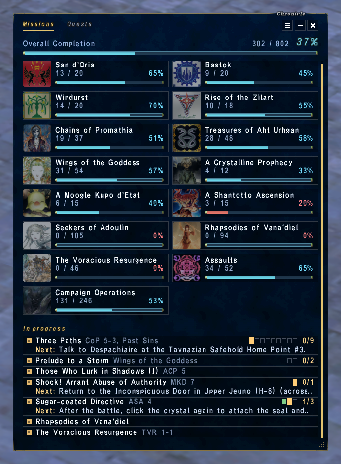
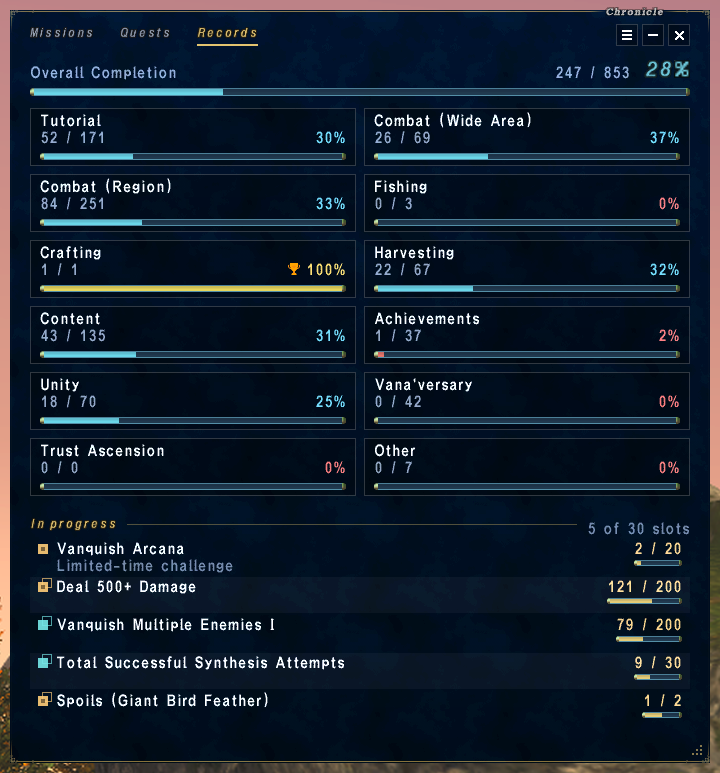
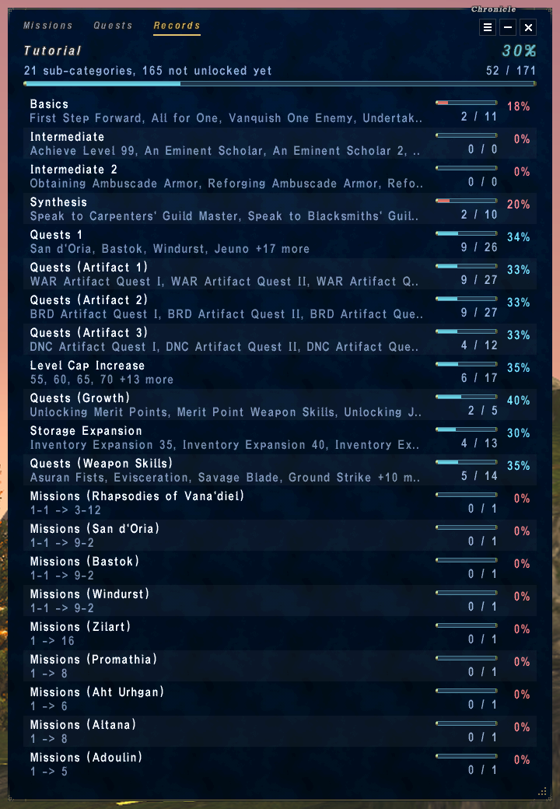
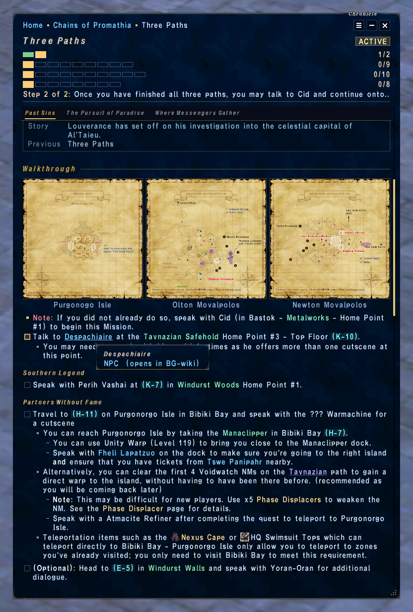
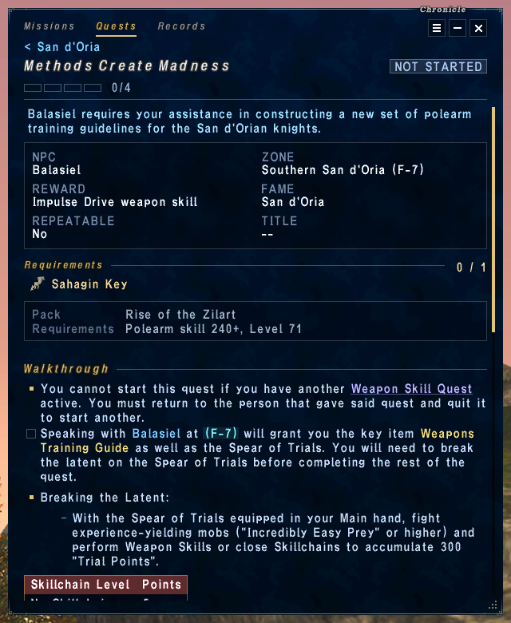

# Chronicle

A quest and mission tracker for Final Fantasy XI, drawn in the game's own windows.

Chronicle shows your completion across every quest area, mission storyline and Records of Eminence
category, lets you browse and search them, checks your bags for what a quest needs, and shows the
walkthrough from BG-wiki with its headings, links, maps and tabs intact.



Version 2 replaces version 1's Windower text boxes with a native drawing layer. The window frame,
the fonts, the gauges and the item icons are read out of the game's own files and drawn above the
game's interface, in whichever of the eight window styles you have set in the game's Config.

- [Features](#features)
- [Installation](#installation)
- [Using it](#using-it)
- [Commands](#commands)
- [What is tracked](#what-is-tracked)
- [Walkthroughs](#walkthroughs)
- [Pictures and credits](#pictures-and-credits)
- [The native layer](#the-native-layer)
- [Upgrading from version 1](#upgrading-from-version-1)
- [Licence](#licence)

## Features

- Completion for 11 quest areas, 15 mission storylines and all 1,508 Records of Eminence
  objectives, read from the game's own quest log and record log
- A home screen with Missions, Quests and Records tabs, overall completion, a card per area, and
  what is in progress with the next step of each
- Every Records objective with its goal, its rewards, whether it repeats, and the server's own
  live count for the ones you have set
- Area lists with search, four sort orders and five filters; an active entry shows its next step
  and how far through it you are
- Guide details per entry: status, description, starting NPC and zone, reward, fame, title, and the
  previous and next entries in the chain
- Requirements checked against every bag and your key items, with the items' own icons
- 1,916 walkthrough pages converted from BG-wiki, with headings, lists, coloured links, item icons,
  boss tables, maps and tabbed panels
- The game's window art in any of its eight window styles, following the game's Config
- Drag to move, drag an edge or the corner to resize, with the text re-wrapping and your place kept
- Window place and size saved per character and per screen size

## Installation

Download the zip from the [latest release](https://github.com/jintawk/ffxi-chronicle/releases/latest)
and copy the `chronicle` folder inside it into `Windower/addons/`, then load it:

```
//lua load chronicle
```

The folder has to be called `chronicle`: Windower loads an addon from
`addons/<name>/<name>.lua`, so GitHub's "Source code (zip)", which unpacks as `ffxi-chronicle-x.y.z`,
will not load until it is renamed.

`libs/_chronicle.dll` is the native drawing layer: 32-bit, built from `plugin/`. If it cannot draw,
because it did not load or because a game update moved the code it looks for, Chronicle says so in
the chat log and then stays out of the way. It draws nothing and takes no input.

The DLL needs the Universal C Runtime, which Windows 10 and 11 include. On Windows 7 or 8.1,
install update KB2999226 first or the DLL will not load.

If Chronicle says `assets missing`, it could not read something out of your game installation. The
message names each piece, why, and the folder it read from, for example
`window art missing (ROM\0\19.DAT: newtex 256x256 not 128x128); ... ; in C:\...`. Only the chat font
is required: without the window art Chronicle draws a plain window instead. If it will not draw at
all, open an issue with that whole line in it.

To build the DLL yourself rather than use the one in the repository:

```sh
sh plugin/build.sh
```

It needs MinGW-w64 i686 and nothing else. The drawing library is
[nui](https://github.com/jintawk/nui), vendored in `plugin/nui`.

## Using it

`//cr` shows or hides the window. Missions, Quests and Records sit at the top of every screen, so
you can always see which of the three you are in, and each one takes you to that section's home.
Click a card, a row or a link to go in; click the blue line above the title, or right-click
anywhere in the window, to go back. Hovering a link shows where it goes. The three
buttons at the top right open Settings, collapse the window, and hide it.


Completion appears when you zone or complete an objective, because that is when the game sends the
quest log. Nothing is sent to the server, and no packet is injected: Chronicle only reads.

### Resizing


The paragraphs re-wrap as the window changes width, and your reading position is kept rather than
jumping to the top.

### Scrolling


## Commands

| Command | What it does |
|---|---|
| `//cr` | Show or hide the window |
| `//cr show` / `hide` | Show or hide |
| `//cr compact` | Collapse or expand |
| `//cr reset` | Reset the window's place and size |
| `//cr refresh` | Redraw with the current data |
| `//cr home` | Back to the home screen |
| `//cr records` | Open the Records of Eminence tab |
| `//cr autoshow` | Show on load, on or off |
| `//cr size [+ \| - \| 0.5-3 \| reset]` | Window size |
| `//cr scale one \| ui \| sim <w> <h> \| auto \| off` | Draw scale: 1:1, the game's UI size, or a simulated screen |
| `//cr wintype auto \| 1-8` | Follow the game's window style, or pin one |
| `//cr uncompletable` | Show quests that can no longer be done |
| `//cr q [area]` / `m [area]` | Summaries in the chat log |
| `//cr status` | Drawing, memory and hook details |
| `//cr progress` / `unknown` / `debug` / `help` | Diagnostics and help |

Every command is also a setting on the Settings screen.

## What is tracked

Two different things are tracked, and it is worth being clear about the difference.

**Completion** is tracked for everything: all 11 quest areas and all 15 mission storylines. If you
have done it, Chronicle knows.

**Steps within an entry** are tracked for about half of the pages: 940 of 1,916. An entry with step
tracking shows how far through it you are, the next thing to do, and a progress strip. An entry
without it still shows its status, its guide card and its full walkthrough; it just has no
checkboxes and no next-step line.

These areas currently show completion only:

| Area | Mapped |
|---|---|
| Campaign Operations | 0 of 246 |
| Coalition | 0 of 95 |
| Assault | 0 of 52 |
| Abyssea | 6 of 192 |
| Crystal War | 12 of 93 |
| Rhapsodies of Vana'diel | 28 of 93 |
| The Voracious Resurgence | 18 of 45 |

Sixty-three entries can never have step tracking, because the game gives no signal between starting
them and finishing them.

### Records of Eminence



The Records tab is the game's own Records of Eminence menu with gauges on it: twelve categories,
112 sub-categories, 1,508 objectives, all read out of the game's own data files, so a game update
that adds objectives or a whole category needs no new Chronicle.

- **Done or not done** comes from the record log the server sends on every zone, which covers every
  objective at once. A repeatable you have finished counts as done even while you are running it
  again.
- **A live count** is shown for the objectives you currently have set: the server sends its own
  number on every kill, so "121 / 200" is exact. For an objective you have not set there is no
  count to show, and Chronicle says so rather than guessing.
- **The middle level** shows what is inside each sub-category, because the game's own names for
  them ("Job Levels 1", "Quests 1") do not.



- **The list** inside a sub-category searches, sorts and filters like any other list in Chronicle, and marks a repeatable record with a second square behind its status.


- **268 objectives wrap a quest or mission** Chronicle already documents. Those link straight into
  that entry, with its walkthrough and its step progress.


- **An objective the game is not offering you yet** is still listed, dimmed, saying which record
  unlocks it. The percentage leaves those out, so it is the figure the game itself would show.

The one requirement Chronicle cannot read is "have you been to this zone", which no packet carries.
Those objectives are shown and counted, and the guide names the zone rather than claiming anything.

## Walkthroughs


Each page keeps BG-wiki's structure: headings, nested lists, tables, and the coloured links for
zones, NPCs, items and coordinates.



Pages with several routes through them, like Chains of Promathia's Three Paths, use real tabs.
Switching tabs never moves the page; only the panel under the tabs changes, and each panel keeps
its own place. Once the tabs scroll out of view a bar of them stays at the top.


Links to entries Chronicle knows about open inside Chronicle. Everything else opens BG-wiki in your
browser.


Click a map to enlarge it.



Requirements are checked against every bag and your key items, so a tick means you are actually
carrying it. Click one to open that item on BG-wiki. Anything the wiki asks for that is not an
item, like a skill level or a rank, is kept as a line of its own under the list.

## Pictures and credits

Walkthrough text comes from [BG-wiki](https://www.bg-wiki.com) and is converted with every visible
word kept. Pictures are not shipped: a page downloads each picture from BG-wiki the first time it
shows it, and keeps it in `data/pics/`. Downloads use HTTPS, and BG-wiki's certificate is checked
against the root certificates in `certs/cacert.pem`.

Credit for the walkthrough text and the pictures belongs to BG-wiki's contributors.

Item icons, window art and fonts are read from your own game installation at run time, read only.
None of them are shipped.

## The native layer

Drawing is done by [nui](https://github.com/jintawk/nui), a BSD-3 library compiled into
`libs/_chronicle.dll`. It patches the game's `EndScene` wrapper to draw above the game's interface,
sharing one patch and one texture cache with any other addon that uses it, so several such addons
can run together whatever versions they were built against.

If a game update moves the code it hooks, it patches nothing and draws nothing rather than guessing,
and `//cr status` reports why.

## Upgrading from version 1

Version 2 reads version 1's settings. These carry over as they are: show on load, collapsed on load,
sort order, filter, the active tab, and whether uncompletable quests are shown. Version 1's `scale`
becomes `size`. Window position moves to `data/places.lua`, which records a place per character and
per screen size, so the first run puts the window at its default and remembers where you move it.

Version 1 is tagged [`v1.4.2`](https://github.com/jintawk/ffxi-chronicle/releases/tag/v1.4.2) if you
want to go back to it.

## Licence

BSD 3-Clause.

`certs/cacert.pem` is Mozilla's CA certificate list as extracted by the curl project
(https://curl.se/docs/caextract.html), under the Mozilla Public License 2.0.

`plugin/nui/stb_image.h` is Sean Barrett's stb_image, public domain / MIT.

Final Fantasy XI is a trademark of Square Enix. This project is not affiliated with or endorsed by
Square Enix.
